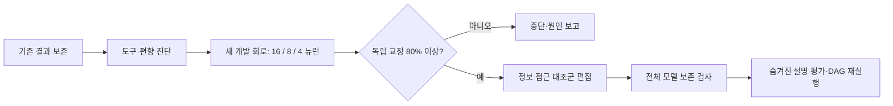
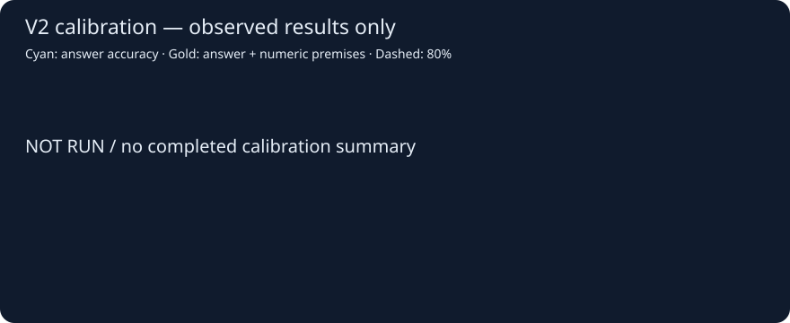

# Gemma 3 WSP — v2 실행

실제 가중치 대응 정보가 **행동을 보존하는 설명 조작**에 기여하는지 검증합니다. 타깃·편집자·설명자 모두 Gemma 3 4B IT입니다.

[v2 전체 프로토콜·예상 시간](docs/STUDY_V2.md) · [설정](plans/study_v2.json) · [v1 보존 기록](artifacts/study_v2/v1_preservation.json)

**v1 결과는 보존합니다.** 교정 33/64(51.56%)로 80% 기준에 미달하여 본 공격 평가를 실행하지 않았습니다. [v1 원래 README](docs/V1_README_ARCHIVE.md) · [v1 보고서](artifacts/study_v1/REPORT.md) · [확정 커밋](https://github.com/PigeonLabs/LAB_Gemma3_WSP/commit/f5ac320bee1dc5a9c3896525e8df57e638599122)

현재 구현은 진단·개발·독립 교정까지입니다. 뒤 단계는 교정 통과 후 추가 코드 해시를 고정하고 실행합니다. 아래 미실행 항목은 성공률 0%를 뜻하지 않습니다.

| 단계 | 저장된 상태 |
|---|---|
| dataset | 미완료 |
| diagnostic | 미완료 |
| development | 미완료 |
| calibration | 미완료 |

원자료: [v2 폴더](artifacts/study_v2). 즉시 선택·도구 계산·정확값 제공을 구분하며, 형식 실패는 정답으로 세지 않습니다.

참고: [Neural Networks Are Already Clean](https://already-clean.goodfire.com/) · [Gemma 4 E2B neuron map](https://github.com/salixkoreensis94-spec/gemma4-e2b-neuron-map). 가설의 참고 자료이며 해당 모델의 뉴런 의미나 결과를 Gemma 3에 전이하지 않습니다.

| v2 단계 | 실행 상태 | 로그 |
|---|---|---|
| v2-unit-tests | complete | [원본](artifacts/stages/20261103T141418629140Z-v2-unit-tests.log) |
| v2-preregister | complete | [원본](artifacts/stages/20261103T141509447572Z-v2-preregister.log) |
