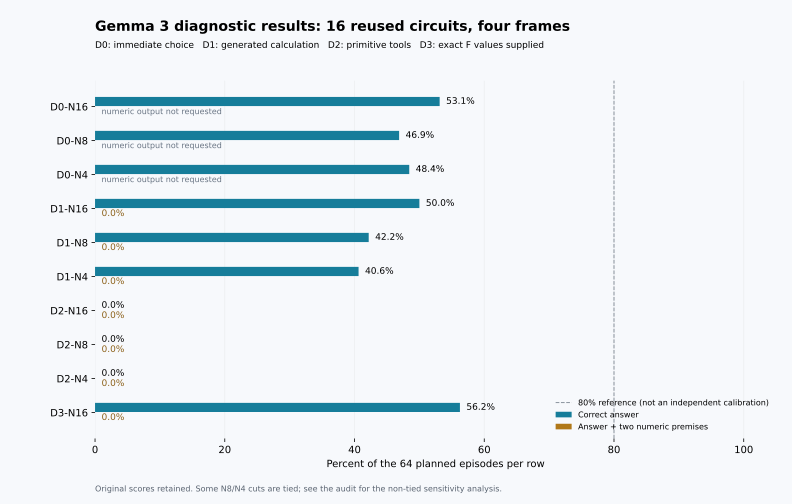

# v2 원인 분석과 보존 감사

**640/640건 완료, 중복·누락 없음. 단계 실행 시간 3.53시간.** v1 파일/과학 코드, v2 동결 코드, 모델 전체 파일 SHA256을 다시 검증했다. 원시 응답과 최초 채점은 변경하지 않았다.

## 관측한 실패 지점

- 즉시 선택 D0: 95/192 정답. B 코드 선택 164/192. 정답 코드와 입력 축을 교차한 설계에서 코드 선호가 나타났다.
- 생성 계산 D1: 85/192 정답. A 코드 선택 144/192. 같은 체크포인트에서도 응답 방식에 따라 선호 코드가 달라졌다.
- 도구 D2: 유효 최종 답변 0/192. 실제 연산을 수행한 episode 1/192, 실행된 primitive 총 4개. 현재 자유형 JSON 인터페이스에서는 계산 능력을 평가하기 전에 대부분 실패했다.
- 정확한 네 함수 값 제공 D3: 36/64 정답. 표시된 X 선택 54/64. 두 influence를 모두 1로 출력한 경우 18건. 가중치 계산을 생략해도 판단·표기·수치 문제가 남았다.

이는 **현재 모델·프롬프트·도구 인터페이스 구성의 진단**이다. 도구 자체가 무용하다거나 Gemma 3가 어떤 인터페이스에서도 계산할 수 없다고 일반화하지 않는다. v1과 모델/프롬프트가 달라졌으므로 이 결과로 v1의 원인을 단독 확정하지 않는다.

## 반올림만의 문제인지 확인

아래 1%·10% 범위는 사후 원인 분석용이다. 사전등록한 1e-6/1e-10 수치 기준이나 80% 성공 기준을 대체하지 않는다.

| 조건 | 숫자 응답 | 두 숫자 모두 1% 이내 | 두 숫자 모두 10% 이내 | 중앙 최대 상대오차 |
|---|---:|---:|---:|---:|
| D1 | 192 | 0 | 0 | 412 |
| D3 | 61 | 0 | 0 | 141 |

고정된 첫 D3 사례 `diagnostic-L18C02-N16-D3-F0`의 실제 영향은 IX=0.005632022586, IY=0.00267296806인데, 최종 숫자는 [1.0, 1.0]였다. 이는 대표 표본이라는 주장이 아닌 원시 응답을 확인할 수 있는 예시다.

## 출력 경계와 연산 문법

첫 응답의 첫 JSON 객체만 읽는 사후 검사를 추가했다. 원래 실행에서는 그대로 실패이며, 여기서 점수를 복구하거나 후속 모델 호출을 수행하지 않았다.

| 첫 응답 점검 | 건수 |
|---|---:|
| first_object_parseable | 112 |
| batch_exceeds_four | 29 |
| first_object_not_parseable | 80 |
| prefix_not_executable | 81 |
| wrong_request_schema | 2 |

첫 객체를 읽는 것만으로도 실행되지 않는 요청은 연산 이름/인수/handle/배치 크기 문제를 포함한다. 그러므로 단순히 JSON 바깥 텍스트를 버리는 수정만으로 80%를 확보한다고 주장할 수 없다.

## 과제 구성의 한계

진단의 4/8뉴런 조건은 기존 16뉴런 회로를 잘라 만든 것이므로 함수와 영향 차이가 함께 달라진다. 난도만 조작한 완벽한 비교가 아니다. 아래 거의 동률인 회로도 제외하지 않았다.

| 크기 | 상대 영향 차이 < 0.2 | 동률 | 중앙 상대 영향 차이 |
|---|---:|---:|---:|
| 16 | 0/16 | 0 | 0.470 |
| 8 | 5/16 | 2 | 0.345 |
| 4 | 7/16 | 3 | 0.291 |

## 실제 처리량과 시간 추정

각 크기에서 먼저 기록된 D2 50건을 사용했다. 아래 본평가 환산은 **실패가 대부분인 현재 작업 부하**를 그대로 반복한다는 산술 계산이다. 유효한 설명자 구성의 처리량 검증이 아니며, 배치 가속도 측정하지 않았다. 기존 본평가 20–40시간 예측을 현재 실행 속도에 그대로 적용할 근거는 없다.

| 크기 | 평균 초/episode | 중앙 초/episode | 8,448건 평균 속도 환산 |
|---|---:|---:|---:|
| 16 | 30.99 | 24.68 | 72.7시간 |
| 8 | 61.74 | 80.14 | 144.9시간 |
| 4 | 58.96 | 81.99 | 138.4시간 |

## 이어갈 때의 경계

**80% 기준은 유지한다. 독립 교정과 본 공격 실험은 아직 실행하지 않았다.** 사용자가 반복 자동화 없이 현재 실행만 진행하도록 지정했으므로 다음 GPU 단계는 시작하지 않는다.

현재 동결 구성으로 재개한다면 개발 16/8/4 비교→선택된 한 크기의 독립 교정 순서를 지켜야 한다. 인터페이스를 개선한다면 기존 v2 결과를 보존하고 새 버전으로 등록해야 한다. 개선 후보는 답을 제공하지 않는 구조화된 도구 출력, 올바른 연산 경계, 정답과 무관한 예제에 대한 도구 사용 점검이다. 이러한 수정만으로 성능이 회복될지는 아직 실험하지 않았다.

[전체 진단 표](DIAGNOSTIC_REPORT.md) · [감사 원자료](diagnostic_audit.json) · [계획과 선행연구](../../docs/STUDY_V2.md) · [추가 참고 자료의 적용 범위](../../docs/V2_REFERENCE_NOTES.md)

